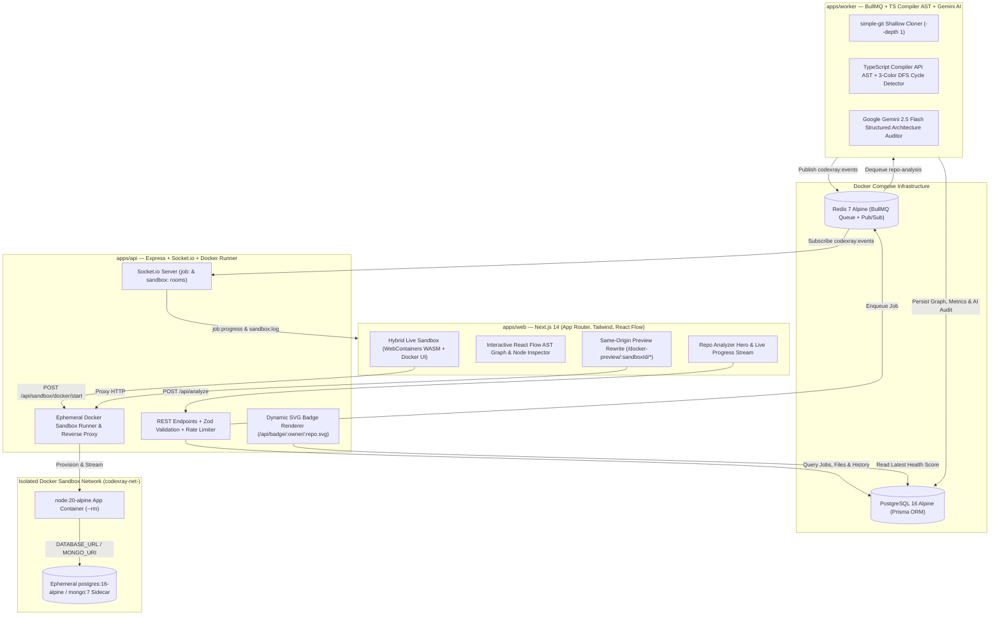
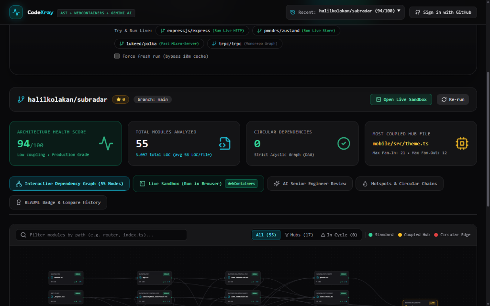
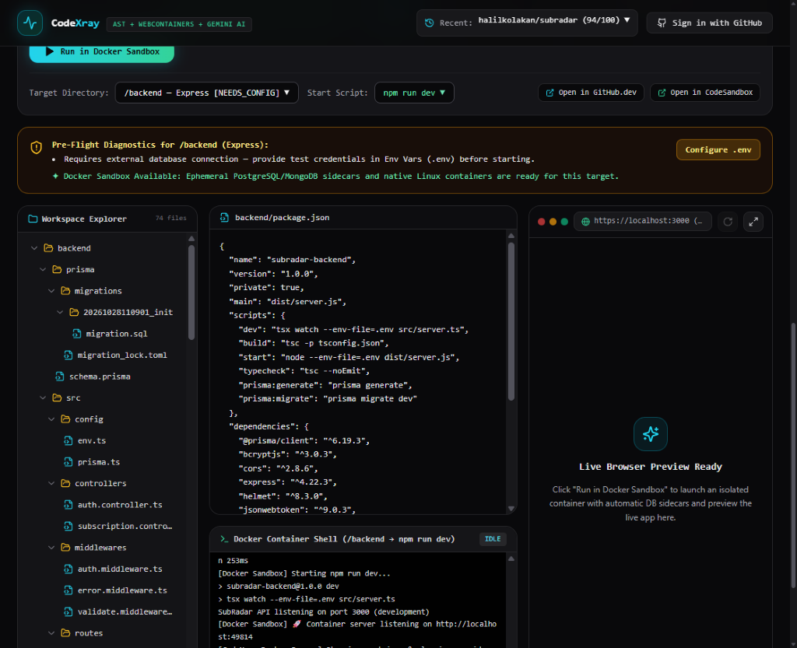

# CodeXray ⚡

**Real-Time GitHub Repository Architecture Visualizer, AST Dependency Graph Analyzer, Hybrid Live Sandbox (WebContainers + Docker), and AI Principal Engineer Code Reviewer.**


**CodeXray** is a full-stack architecture intelligence and live execution platform for GitHub repositories. Paste any public GitHub URL to shallow-clone the repository into an isolated worker workspace, parse its TypeScript/JavaScript Abstract Syntax Tree (AST) via the TypeScript Compiler API, detect circular dependency chains with 3-color Depth-First Search (DFS), stream real-time pipeline telemetry over BullMQ + Redis Pub/Sub + Socket.io, generate a structured Principal Engineer audit with Google Gemini, and boot the repository live in your browser via **WebContainers (WASM)** or an **Ephemeral Docker Sandbox** with automatic PostgreSQL/MongoDB sidecar provisioning.

---

## 🌟 Core Capabilities

1. **Compiler-Grade AST Dependency Graph Visualizer**
   - Recursively scans `.ts`, `.tsx`, `.js`, `.jsx` modules (up to 1,500 files, filtering out `node_modules`, `dist`, `.next`, and build artifacts).
   - Uses `ts.createSourceFile` from the TypeScript Compiler API to extract static ESM `import`/`export` declarations, dynamic `import()` expressions, and CommonJS `require()` calls.
   - Resolves relative paths, index barrels, and workspace aliases (`@/*`, `~/*`) into an interactive **React Flow** node-link graph with custom dark-mode nodes (`MODULE`, `HUB`, `CYCLE`), search/category filters, and a **Module Inspector Drawer** showing LOC, Fan-In dependents, Fan-Out imports, and exported symbols.

2. **3-Color DFS Cycle Detection & Deterministic Health Score (0–100)**
   - Runs a 3-color (`WHITE` / `GRAY` / `BLACK`) Depth-First Search graph traversal to detect mutual and multi-hop circular dependency chains.
   - Computes per-module `fanIn` and `fanOut` coupling metrics, highlights high-coupling hub modules, and calculates a deterministic 0–100 Architecture Health Score.

3. **Real-Time BullMQ + Redis Pub/Sub + Socket.io Pipeline**
   - Asynchronous job processing powered by **BullMQ** (`repo-analysis` queue) and **Redis 7**.
   - Streams granular stage transitions (`QUEUED` → `CLONING` → `PARSING` → `AI_REVIEW` → `COMPLETED` / `FAILED`) and live terminal logs over Redis Pub/Sub (`codexray:events`) bridged to scoped Socket.io rooms (`job:<jobId>`).

4. **Gemini AI Principal Engineer Architecture Review**
   - Feeds structural AST telemetry (top coupled hubs, circular dependency chains, directory hierarchy, and `package.json` manifests) into **Google Gemini (`gemini-2.5-flash`)** using structured JSON output validated by Zod (`AiReviewSchema`).
   - Generates an executive architecture summary, detected architectural pattern, **Top 3 Engineering Strengths**, **Top 3 Risk Hotspots**, and a **New Developer Onboarding Guide**.

5. **Hybrid Live Sandbox: Browser WebContainers (WASM) + Ephemeral Docker Runner**
   - **Browser WASM Mode (`@webcontainer/api`)**: Instant zero-server-cost Node.js WebAssembly runtime in the browser with a 3-pane IDE (Workspace File Explorer, live HMR Code Editor, ANSI-clean Terminal Console, and Live Preview `<iframe>`), monorepo target/sub-package selector, in-memory `.env` editor, automatic `npx prisma generate`, and fatal crash detection (`ECONNREFUSED`, `MODULE_NOT_FOUND`, `Error: P1001`) with a 1-click **Switch to Docker Sandbox** recovery action.
   - **Docker Sandbox Mode (`node:20-alpine` + Auto DB Sidecars)**: Provisions an isolated `node:20-alpine` container (`--rm`, `--memory=1536m`, `--cpus=1.5`, 15-minute idle TTL) on an isolated Docker bridge network (`codexray-net-<sandboxId>`). Automatically detects Prisma/PostgreSQL or Mongoose/MongoDB dependencies, boots an ephemeral `postgres:16-alpine` or `mongo:7` sidecar container, waits for health readiness (`pg_isready`), injects `DATABASE_URL` / `MONGO_URI`, runs `npx prisma generate && npx prisma db push`, streams live container stdout/stderr over Socket.io (`sandbox:<sandboxId>`), and serves the live app through a same-origin Next.js reverse proxy (`/docker-preview/<sandboxId>/`) with an interactive **Live Docker API Sandbox Inspector** fallback for REST API backends.

6. **Dynamic Shields.io-Style SVG Badges & GitHub OAuth**
   - Embed live repository health scores in any `README.md` via `GET /api/badge/:owner/:repo.svg`.
   - Optional **Sign in with GitHub** (`/api/auth/github`) with JWT HTTP-only cookies to save analysis history and benchmark two repositories side-by-side.

---

## 🏗️ System Architecture



```text
+-----------------------------------------------------------------------------------+
|                        apps/web (Next.js 14 • Port 3000)                          |
|  [React Flow AST Graph]   [AI Senior Review]   [Hybrid WASM & Docker Live IDE]   |
+-------------------+-----------------------------------+---------------------------+
                    | REST + Socket.io                  | /docker-preview/:id/*
                    v                                   v
+-----------------------------------------------------------------------------------+
|                        apps/api (Express • Port 4000)                             |
|  [BullMQ Producer]   [Redis Pub/Sub -> Socket.io]   [Docker Sandbox Reverse Proxy]|
+---------+-----------------------------+-----------------------------------+-------+
          |                             |                                   |
          v                             v                                   v
+-------------------+       +-----------------------+       +-----------------------+
|  PostgreSQL 16    |       |     Redis 7 Alpine    |       | Ephemeral Containers  |
|  (Prisma Schema)  |       | (BullMQ + Pub/Sub)    |       | node:20 + PG/Mongo DB |
+---------+---------+       +-----------+-----------+       +-----------------------+
          ^                             |
          | Persist Results             v Dequeue Job
+---------+-----------------------------+-------------------------------------------+
|                        apps/worker (BullMQ Worker)                                |
|  1. simple-git (--depth 1)  ->  2. TS Compiler AST + DFS  ->  3. Gemini 2.5 Flash |
+-----------------------------------------------------------------------------------+
```

---

## 🛠️ Tech Stack

| Layer | Technologies |
| :--- | :--- |
| **Frontend (`apps/web`)** | Next.js 14 (App Router, TypeScript), React 18, Tailwind CSS, `reactflow` (interactive node-link graph), `@webcontainer/api` (in-browser Node.js WASM runtime), `socket.io-client`, `lucide-react` |
| **Backend API (`apps/api`)** | Node.js, Express, TypeScript, Socket.io, `bullmq`, `ioredis`, Prisma Client, Zod validation, `helmet`, `express-rate-limit`, `simple-git`, Docker CLI container & sidecar orchestrator |
| **Analysis Worker (`apps/worker`)** | Node.js, TypeScript, `bullmq`, `ioredis`, `simple-git`, `typescript` (Compiler API for AST import/export extraction & 3-color DFS cycle detection), `@google/genai` (`gemini-2.5-flash`) |
| **Shared (`packages/shared`)** | Shared Prisma Client singleton, Zod validation schemas, DTO contracts, and Redis Pub/Sub / Socket.io event definitions |
| **Infrastructure & Database** | PostgreSQL 16 (`postgres:16-alpine`), Prisma ORM, Redis 7 (`redis:7-alpine`), Docker Compose with healthchecks and named volumes |

---

## 📸 Screenshots

| Interactive AST Dependency Graph & Inspector | Hybrid Live Sandbox (WebContainers + Docker Runner) |
| :---: | :---: |
|  |  |

---

## 🚀 3-Step Local Setup

### Prerequisites
- **Node.js** `>= 20.0.0` & **npm**
- **Docker Desktop** (for PostgreSQL 16, Redis 7, and the optional Docker Sandbox Runner)
- **Git** installed on `PATH`

### Step 1 — Start Infrastructure & Install Dependencies
```bash
cp .env.example .env
docker compose up -d
npm install
```
*(Optional: Add your `GEMINI_API_KEY`, `GITHUB_TOKEN`, and GitHub OAuth credentials to `.env`. Even without keys, AST parsing, cycle detection, and the Live Sandbox work out of the box with deterministic fallback reviews.)*

### Step 2 — Run Database Migrations & Build Shared Contracts
```bash
npx prisma migrate dev --name init
npm run build:shared
```

### Step 3 — Start All Services (`api`, `worker`, `web`)
```bash
npm run dev
```
*(Or run each workspace in its own terminal: `npm run dev:api`, `npm run dev:worker`, and `npm run dev:web`.)*

- **Web Application**: [http://localhost:3000](http://localhost:3000)
- **API Healthcheck**: [http://localhost:4000/api/health](http://localhost:4000/api/health)
- **SVG Health Badge**: `http://localhost:4000/api/badge/:owner/:repo.svg`

---

## 🔒 Security & Production Engineering

- **Zero Shell Interpolation on Git URLs**: Repository URLs are validated with strict Zod regex (`^https:\/\/github\.com\/[a-zA-Z0-9_.-]+\/[a-zA-Z0-9_.-]+$`) and cloned exclusively via `simple-git` argument arrays (`['--depth', '1', '--single-branch', '--no-tags']`).
- **Lifecycle Script Sanitization**: Before mounting untrusted repositories into WebContainers or Docker Sandbox containers, `preinstall`, `postinstall`, and `prepare` lifecycle hooks are stripped from `package.json`.
- **Resource-Capped Ephemeral Containers**: Docker Sandbox containers run with `--rm`, `--memory=1536m`, `--cpus=1.5`, isolated per-session networks, and automatic 15-minute idle TTL cleanup.
- **Guaranteed Disk Cleanup**: Both AST worker clones and Docker sandbox clones execute inside scoped temporary directories and are force-cleaned on job completion or container stop.
